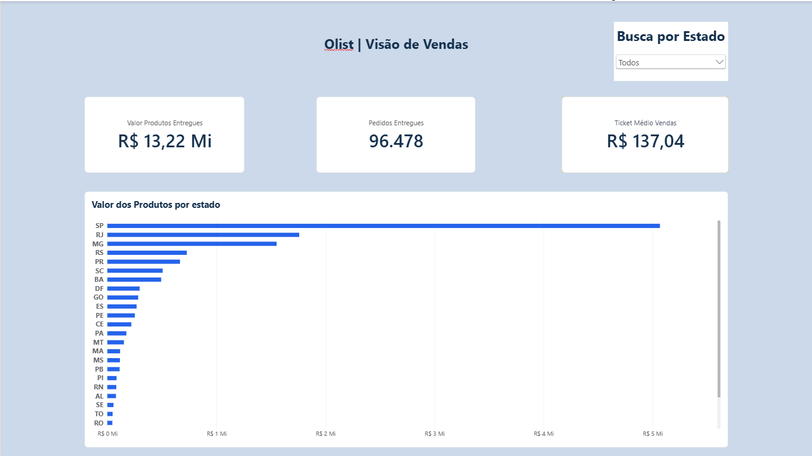
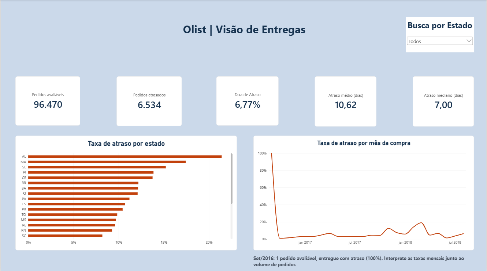

# Olist — Análise de vendas e atrasos nas entregas

O Rio de Janeiro se destaca como prioridade para investigação: foram **1.495 pedidos atrasados**, com taxa de **12,11%**, frente a **6,77%** no conjunto de pedidos avaliáveis. Entre os pedidos atrasados do estado, o atraso médio foi de **13,52 dias**.

São Paulo concentrou **38,33% do valor dos produtos vendidos** e o maior número absoluto de atrasos: **1.820 pedidos**. Alagoas apresentou a maior taxa de atraso entre os estados, **21,41%**, em uma base de **397 pedidos avaliáveis**.

Esses resultados sugerem prioridades diferentes de investigação. A análise combina volume, proporção e duração dos atrasos, sem atribuir causas que os dados não permitem comprovar.

Projeto desenvolvido por **Caio Precioso Prado** com **Python, SQL Server, Excel e Power BI**.

## Objetivo

Identificar quais estados concentram o valor dos produtos vendidos e quais merecem investigação por atrasos nas entregas.

Perguntas que orientaram o projeto:

- Quais estados concentram o valor dos produtos dos pedidos entregues?
- Qual é a taxa de atraso entre os pedidos que podem ser avaliados?
- Onde há mais atrasos em quantidade e em proporção?
- Qual é a duração dos atrasos?
- Como as taxas variam conforme o mês da compra?

## Dashboards

### Vendas



### Entregas



O arquivo do relatório está disponível em [portfolio_olist.pbix](Power_BI/portfolio_olist.pbix) e pode ser aberto no Power BI Desktop.

As imagens permitem consultar a apresentação sem instalar o Power BI.

## Principais indicadores

| Indicador                                 |        Resultado |
| :---------------------------------------- | ---------------: |
| Pedidos entregues                         |           96.478 |
| Valor dos produtos dos pedidos entregues  | R$ 13.221.498,11 |
| Frete dos pedidos entregues               |  R$ 2.198.275,64 |
| Ticket médio sem frete                    |        R$ 137,04 |
| Pedidos avaliáveis quanto ao prazo        |           96.470 |
| Pedidos entregues com atraso              |            6.534 |
| Taxa de atraso                            |            6,77% |
| Atraso médio entre os pedidos atrasados   |       10,62 dias |
| Atraso mediano entre os pedidos atrasados |           7 dias |

São Paulo concentra **38,33%** do valor dos produtos dos pedidos entregues, seguido pelo Rio de Janeiro, com **13,31%**, e por Minas Gerais, com **11,74%**.

### Prioridades sugeridas para investigação

| Estado | Pedidos avaliáveis | Pedidos atrasados | Taxa de atraso | Atraso médio dos atrasados |
| :----- | -----------------: | ----------------: | -------------: | -------------------------: |
| RJ     |             12.350 |             1.495 |         12,11% |                 13,52 dias |
| AL     |                397 |                85 |         21,41% |                  9,54 dias |
| SP     |             40.494 |             1.820 |          4,49% |                  8,33 dias |

- **Rio de Janeiro:** combina grande quantidade de atrasos, taxa superior à taxa geral e duração média superior à média geral dos atrasados.
- **Alagoas:** apresenta a maior taxa de atraso entre os estados, com volume menor de pedidos. A investigação deve considerar o tamanho dessa base.
- **São Paulo:** apresenta o maior número absoluto de atrasos, embora sua taxa seja inferior à taxa geral.

Como próximo passo de investigação, faz sentido examinar os períodos de maior concentração de atrasos e sua duração em cada estado. Esses resultados, isoladamente, não justificam decisões de investimento nem identificam responsáveis pelos atrasos.

## Fonte dos dados

[Brazilian E-Commerce Public Dataset by Olist — Kaggle](https://www.kaggle.com/datasets/olistbr/brazilian-ecommerce)

Arquivos utilizados:

| Arquivo                         | Conteúdo                                   |
| :------------------------------ | :----------------------------------------- |
| `olist_orders_dataset.csv`      | Pedidos, status e datas                    |
| `olist_customers_dataset.csv`   | Identificadores e localização dos clientes |
| `olist_order_items_dataset.csv` | Itens dos pedidos, preços e fretes         |

A base de pedidos contém **99.441 registros**. A base de itens contém **112.650 registros**, distribuídos em **98.666 pedidos distintos**.

Os CSVs originais não são incluídos no repositório. Para executar as análises, obtenha-os na fonte e coloque-os na pasta `dados_originais`.

Consulte na página da fonte os termos de uso e a licença dos dados.

## Regras dos indicadores

| Indicador ou recorte | Regra                                                                           |
| :------------------- | :------------------------------------------------------------------------------ |
| Vendas               | Considera somente pedidos com status `delivered`                                |
| Valor dos produtos   | Soma de `price` dos itens desses pedidos, sem frete; não representa lucro       |
| Frete                | Soma de `freight_value` dos itens dos pedidos entregues                         |
| Ticket médio         | Valor dos produtos dividido pela quantidade de pedidos distintos entregues      |
| Pedido avaliável     | Pedido entregue com data real de entrega ao cliente e data prevista preenchidas |
| Entrega atrasada     | Data real posterior à data prevista, comparando somente o dia                   |
| Taxa de atraso       | Pedidos atrasados divididos pelos pedidos avaliáveis do mesmo recorte           |
| Dias de atraso       | Diferença em dias entre entrega real e previsão, somente para pedidos atrasados |
| Análise mensal       | Agrupamento pelo mês da compra                                                  |
| Estado               | Campo `customer_state` da tabela de clientes                                    |

Os **oito pedidos entregues sem data de entrega ao cliente** permanecem na análise de vendas, mas são excluídos dos indicadores de prazo.

### Cuidados com as ligações entre tabelas

Um pedido pode possuir vários itens. Na análise de vendas em Python, os valores dos itens são somados por pedido antes da ligação com a tabela de pedidos, preservando uma linha por pedido.

A quantidade de linhas de itens não deve ser confundida com a quantidade de pedidos distintos. O campo `order_item_id` identifica a posição do item dentro do pedido e não representa uma coluna de quantidade vendida.

A ligação com clientes utiliza `customer_id`. Esse identificador não deve ser confundido com `customer_unique_id`, utilizado para reconhecer clientes que aparecem em diferentes pedidos.

## Desenvolvimento e validação

### Python

- Exploração dos CSVs e conferência do nível de detalhe de cada tabela.
- Verificação de valores ausentes e identificadores duplicados.
- Conversão de datas e comparação dos prazos sem considerar horários.
- Ligação entre pedidos e clientes.
- Agregação dos valores dos itens por pedido.
- Cálculo de indicadores de vendas e entregas.
- Exportação dos resumos utilizados nas etapas seguintes.

### SQL Server

- Importação dos dados e conferência dos tipos das colunas.
- Validação dos indicadores com `JOIN`, `GROUP BY`, CTEs, `CASE`, `COUNT`, `SUM`, `AVG` e `DATEDIFF`.
- Comparação dos resultados com os cálculos realizados em Python.

Durante a importação, foi identificado um problema de conversão decimal: o valor `58.90` havia sido interpretado como `5890.00`.

A correção utilizou uma tabela auxiliar com os valores de origem. Os totais foram conferidos antes da confirmação da transação. O procedimento está documentado no repositório.

### Excel

- Tabela dinâmica com pedidos avaliáveis e atrasados por estado.
- Cálculo da taxa de atraso pela divisão dos totais.
- Formatação condicional e gráfico de comparação.

### Power BI

- Modelo com as tabelas de pedidos, itens e clientes.
- Colunas calculadas e medidas em DAX.
- Páginas de vendas e entregas com filtro por estado.
- Conferência dos principais indicadores com os resultados das demais ferramentas.

As ferramentas foram utilizadas em etapas complementares. Os scripts Python não atualizam automaticamente o SQL Server, e o relatório Power BI utiliza sua conexão com o banco.

## Organização dos arquivos

| Local              | Conteúdo                                                             |
| :----------------- | :------------------------------------------------------------------- |
| `scripts_python/`  | Scripts de exploração, vendas e preparação da base Excel             |
| `SQL/`             | Estrutura das tabelas, registro da correção e consultas de validação |
| `dados_originais/` | CSVs obtidos na fonte, mantidos localmente                           |
| `dados_tratados/`  | Resumos em CSV e arquivos Excel                                      |
| `Power_BI/`        | Relatório `.pbix`                                                    |
| `Imagens/`         | Capturas dos dashboards                                              |
| `requirements.txt` | Dependências diretas do Python                                       |
| `.gitignore`       | Regras de exclusão de arquivos do versionamento                      |

## Como executar as análises em Python

Ambiente utilizado:

- Python 3.14.2
- pandas 2.3.3
- openpyxl 3.1.5

1. Baixe o projeto e preserve a organização das pastas.
2. Crie `dados_originais` se ela não existir e adicione os três CSVs.
3. Garanta que a pasta `dados_tratados` exista.
4. Abra o terminal na pasta principal do projeto.
5. Instale as dependências:

```bash
python -m pip install -r requirements.txt
```

6. Execute os scripts:

```bash
python scripts_python/01_exploracao.py
python scripts_python/02_analise_vendas.py
python scripts_python/03_preparacao_excel.py
```

Arquivos gerados:

| Script                   | Saída                           |
| :----------------------- | :------------------------------ |
| `01_exploracao.py`       | `resumo_atrasos_estado_mes.csv` |
| `02_analise_vendas.py`   | `resumo_vendas_estado.csv`      |
| `03_preparacao_excel.py` | `base_entregas.xlsx`            |

O script 02 pode executar independentemente do script 01.

O script 03 depende do resumo gerado pelo script 01. Ele prepara a base em Excel, mas não recria a tabela dinâmica e o gráfico da planilha final `analise_entregas.xlsx`.

## Como consultar as análises em SQL

É necessário ter SQL Server, SSMS e o banco `portfolio_olist` com as tabelas carregadas.

A importação utilizada no desenvolvimento foi realizada pelo assistente **Importar Arquivo Simples** do SSMS:

| CSV                             | Tabela         |
| :------------------------------ | :------------- |
| `olist_orders_dataset.csv`      | `dbo.pedidos`  |
| `olist_customers_dataset.csv`   | `dbo.clientes` |
| `olist_order_items_dataset.csv` | `dbo.itens`    |

O assistente cria as tabelas durante a importação.

O arquivo `SQL/00_criacao_tabelas.sql` registra a estrutura final para referência ou para uma carga alternativa em tabelas previamente criadas. Ele não importa os CSVs nem cria o banco.

Confira os tipos das colunas, os campos que permitem valores ausentes e a interpretação do ponto decimal antes de validar os resultados.

Após a carga, execute:

1. `SQL/01_validacao_vendas.sql`
2. `SQL/02_validacao_entregas.sql`

O arquivo `SQL/00_correcao_importacao_itens.sql` documenta uma correção específica do desenvolvimento. Depende de `dbo.itens_importacao` e não deve ser executado como uma etapa obrigatória em uma importação já correta.

## Como visualizar o relatório

Abra `Power_BI/portfolio_olist.pbix` no Power BI Desktop.

Para atualizar os dados, configure a conexão com sua instância do SQL Server e disponibilize o banco com as tabelas correspondentes.

As capturas na pasta `Imagens` permitem visualizar a apresentação sem abrir o arquivo `.pbix`.

## Limitações e cuidados de interpretação

- Os resultados descrevem o conjunto histórico utilizado, não a operação atual da empresa.
- Os indicadores de prazo consideram somente pedidos entregues com datas disponíveis. Não medem pedidos ainda em trânsito.
- A taxa geral é calculada pelos totais, não pela média simples das taxas dos estados ou dos meses.
- A análise mensal utiliza o mês da compra, não o mês da entrega.
- Setembro de 2016 possui apenas um pedido avaliável, entregue com atraso, resultando em 100%. Taxas devem ser interpretadas junto ao volume.
- O Amapá possui dois pedidos atrasados, com atrasos de 144 dias e 1 dia. A média de 72,5 dias não indica que esse seja um comportamento recorrente.
- O valor dos produtos não representa lucro nem receita da plataforma Olist.
- A análise não identifica causas operacionais nem estima margem de lucro.
- O gráfico do Excel utiliza uma tabela auxiliar com valores fixos. Se a base mudar, essa tabela também precisa ser atualizada.

## Possíveis evoluções

As melhorias abaixo ainda não foram implementadas:

- Ampliar a análise mensal em SQL com funções de janela, como `LAG`, para comparar taxas entre meses, tratando meses sem registros e expressando variações em pontos percentuais.
- Investigar a associação entre atrasos e avaliações dos clientes, sem interpretar associação como causalidade.
- Explorar indicadores por vendedor, considerando que um pedido pode conter itens de diferentes vendedores.
- Disponibilizar um vídeo curto de navegação ou uma versão online do dashboard.

## Aprendizados

- Distinguir linhas de itens, unidades e pedidos distintos.
- Preservar o nível de detalhe dos dados ao realizar ligações.
- Tratar informações ausentes sem inventar valores.
- Identificar e corrigir problemas de interpretação de números decimais.
- Validar indicadores entre ferramentas.
- Comparar volume, proporção e duração antes de recomendar uma investigação.
- Documentar regras, limitações e instruções de execução.

## Autor e contato

**Caio Precioso Prado**

- [LinkedIn](https://www.linkedin.com/in/caio-precioso-prado)
- [GitHub](https://github.com/Caioba0110)
- E-mail: [caiopreciosoprado@gmail.com](mailto:caiopreciosoprado@gmail.com)
